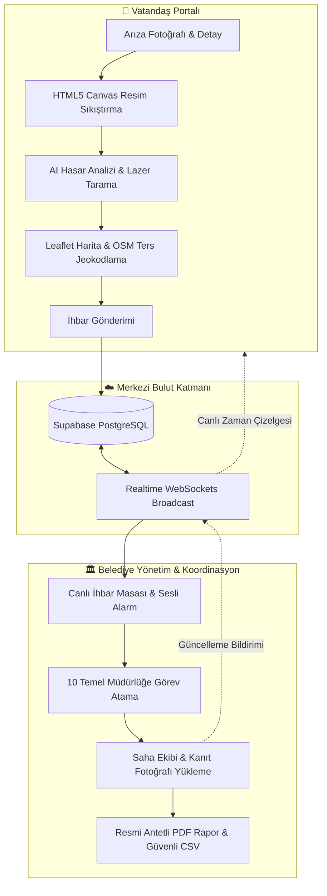

# 🏙️ Akıllı Kent Ağı (AKA) — Afyonkarahisar Belediyesi
### Yeni Nesil Coğrafi Bilgi Sistemi (CBS) & Gerçek Zamanlı Belediye Arıza Yönetim Platformu

Vatandaşlar ile belediye koordinasyon birimleri arasındaki iletişimi dijitalleştiren; harita tabanlı arıza bildirimi, yapay zeka hasar analizi, süreç denetim geçmişi (audit trail) ve anlık WebSocket senkronizasyonu sağlayan uçtan uca modern belediyecilik platformu.

---

## 🌐 Canlı Demo & Hızlı Erişim

* **Canlı Web Uygulaması:** [https://silagundogar.github.io/akilli-kent-agi/](https://silagundogar.github.io/akilli-kent-agi/)
* **Yerel Başlatma:** Proje dizininde `index.html` dosyasına çift tıklayarak veya `powershell .\start-server.ps1` komutuyla doğrudan çalıştırabilirsiniz.

---

## 🏗️ Sistem Mimarisi & Veri Akışı

---

## 🚀 Öne Çıkan Mühendislik & Yazılım Özellikleri

### 1. 🗄️ Merkezi Bulut Veritabanı & Çift Katmanlı Senkronizasyon (Supabase)
* **Realtime WebSockets:** Bir vatandaş telefonundan ihbar açtığı salise, belediyedeki yetkilinin ekranı yenilenmeden sesli alarm çalar ve ihbar masasına canlı olarak düşer.
* **Dual-Cache Güvenliği:** Veriler hem PostgreSQL bulutunda tutulur hem de `LocalStorage` ile önbelleğe alınır. İnternet kopsa dahi arayüz asla donmaz veya çökmez.
* **Row Level Security (RLS):** Veritabanı seviyesinde anonim vatandaş bildirimleri ve yetkili personel erişim kuralları izoledir.

### 2. 🗺️ Afyonkarahisar Odaklı Coğrafi Bilgi Sistemi (CBS)
* Doğrudan **Afyonkarahisar Zafer Meydanı (`38.7569, 30.5387`)** merkezli Leaflet & CartoDB Voyager harita katmanı.
* **Otomatik Ters Jeokodlama (Reverse Geocoding):** Vatandaş haritada bir noktaya tıkladığında, OpenStreetMap Nominatim API üzerinden Afyonkarahisar'ın gerçek mahalle ve cadde ismi (örn: *Ambaryolu Cad., Marulcu Mah.*) form kutusuna anında doldurulur.
* Şehrin 19 ana mahallesi entegre edilmiştir.

### 3. 🏢 10 Temel Belediye Birimi & Sevk Yönetimi
Tüm belediyecilik süreçlerini kapsayan 10 uzman müdürlük:
1. **Fen İşleri Müdürlüğü** (Yol, Asfalt, Kaldırım, Bordür)
2. **Su ve Kanalizasyon İdaresi (AFSU)** (Ana Şebeke Patlakları, Kanalizasyon, Rögar)
3. **Elektrik & Aydınlatma Şefliği** (Sokak Lambaları, Park Aydınlatması)
4. **Park ve Bahçeler Müdürlüğü** (Oyun Parkları, Budama, Yeşil Alanlar)
5. **Temizlik İşleri Müdürlüğü** (Konteyner Boşaltma, Sokak Yıkama, Moloz)
6. **Zabıta Müdürlüğü** (Kaldırım İşgali, Seyyar Satıcı, Denetim)
7. **Veteriner İşleri Müdürlüğü** (Yaralı Sokak Hayvanı, Hayvan Ambulansı)
8. **Ulaşım Hizmetleri Müdürlüğü** (Trafik Işıkları, Duraklar, Tabelalar)
9. **İmar ve Şehircilik Müdürlüğü** (Kaçak Yapı, Metruk Binalar)
10. **Sosyal Yardım İşleri Müdürlüğü** (Evde Bakım, Engelli Destek)

### 4. 🔒 Rol Tabanlı Personel Güvenliği (RBAC)
Belediye masası şifreli giriş ile korunmaktadır. Test etmek için sisteme tanımlı hazır personel rolleri:

| Rol | Kullanıcı Adı | Şifre | Yetki Kapsamı |
| :--- | :--- | :--- | :--- |
| **Genel Koordinasyon Amiri** | `admin` | `afyon153` | Tüm birimleri görme, atama ve resmi rapor üretme |
| **Fen İşleri Saha Amiri** | `fenisleri` | `153` | Yol, kaldırım ve asfalt ekiplerini yönetme |
| **Zabıta Nöbetçi Komiseri** | `zabita` | `153` | Devriye yönlendirme ve çevre denetimi |
| **AFSU Nöbetçi Teknikeri** | `afsu` | `153` | Su arıza ve hat operatörü sevk |

### 5. 💬 Nöbetçi Birim Uzmanları Masası & WhatsApp Entegrasyonu
Yapay zeka yerine, doğrudan **saha telsizi başındaki nöbetçi belediye uzmanlarıyla canlı iletişim**:
* 🟢 **Resmi WhatsApp Hattında Aç:** Afyonkarahisar Belediyesi'nin resmi hattı (`0530 256 03 03`) tek tıkla açılır.
* 📞 **ALO 153 Beyaz Masa:** Doğrudan arama bağlantısı.
* **Canlı Nöbetçi Uzmanlar:** İnş. Müh. Murat Kaya (Fen İşleri), Tekniker Kemal Arslan (AFSU), Komiser Hakan Bayrak (Zabıta), Vet. Hekim Selin Toker (Veteriner), İbrahim Yurt (Temizlik). Uzmanlar mesaj geldiğinde telsizden ekipleri sevk eder ve sisteme iş emri açar.

### 6. 🛡️ Güvenlik & Performans Optimizasyonları
* **İstemci Taraflı Resim Sıkıştırma (HTML5 Canvas):** 5-10 MB'lık kamera fotoğraflarını istemci tarafında saniyeler içinde ~80 KB'a indirip bant genişliğini ve depolama kotasını korur.
* **XSS Sanitization:** `escapeHtml` fonksiyonu ile tüm kullanıcı girdileri temizlenir.
* **CSV Formula Injection Koruması:** Excel dışa aktarımında formül enjeksiyonu (`=`, `+`, `-`, `@`) atakları filtrelenir.
* **Resmi Antetli PDF Raporu:** Barkodlu, resmi antetli ve imzaya hazır tekil veya toplu belediye faaliyet raporu çıktısı.

---

## 🛠️ Teknoloji Yığını (Tech Stack)

* **Ön Yüz (Frontend):** Vanilla JavaScript (ES6+), HTML5, Tailwind CSS, Lucide Icons, Canvas Confetti
* **Harita & CBS:** Leaflet.js, OpenStreetMap Nominatim Geocoding API, CartoDB Voyager Tiles
* **Veritabanı & Gerçek Zamanlı:** Supabase, PostgreSQL 15, Realtime WebSocket Channels
* **Analitik:** Chart.js (Mahalle Yoğunluk & Birim Dağılım Grafikleri)
* **DevOps & Hosting:** GitHub Pages (Frontend), Oracle Cloud Always Free VPS Ready (Ubuntu 24.04 LTS, Nginx, Let's Encrypt SSL)

---

## 📜 Lisans & Geliştirici

Bu proje, açık kaynak topluluğu ve kamu yararına akıllı belediyecilik çözümleri üretmek amacıyla geliştirilmiştir.

* **Geliştirici:** Sıla Gündoğar
* **Lisans:** MIT License
